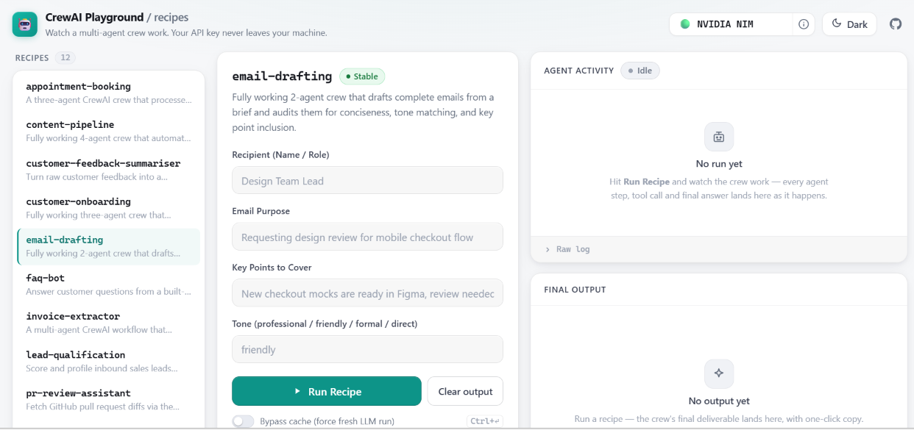

# CrewAI Recipes Playground

A local, lightweight web interface to test your recipes. **This runs entirely on your local machine; your API key never leaves your device.**



## Quickstart

1. Navigate to the playground directory:
   ```bash
   cd playground
   ```
2. Create a virtual environment and install dependencies:
   ```bash
   python -m venv .venv
   source .venv/bin/activate
   pip install -r requirements.txt
   ```
3. Set your LLM API Key:
   ```bash
   cp .env.example .env
   # Edit .env and add: LLM_API_KEY=nvapi-...
   ```
4. Start the server:
   ```bash
   uvicorn main:app --reload
   ```
5. Open [http://127.0.0.1:8000](http://127.0.0.1:8000) in your browser.

## API

### `GET /health`
Liveness probe endpoint. Returns service health status and discovered recipes.

### `POST /run`
Synchronous recipe execution. Executes a recipe with input parameters and returns the final string output.

- Supported body: `{"recipe": "faq-bot", "inputs": {...}, "no_cache": false}`
- Returns HTTP 200 on success, HTTP 429 on rate limit or token budget breach, HTTP 503 on open circuit.

### `POST /run/stream`
Server-Sent Events (SSE) streaming endpoint. Emits real-time execution events (`agent_step`, `task_complete`, `log`, `governance`, `complete`, `error`).

### `WS /run/ws`
Full-duplex WebSocket endpoint for real-time bidirectional execution and step streaming.

---

## Governance & Operational Resilience (#279)

The Playground includes a resilient governance engine (`playground/governance.py`) to manage provider stability, prevent cascading outages, and enforce budget ceilings.

### 1. Provider Circuit Breakers
- **State Machine:** Tracks provider health across `CLOSED`, `OPEN`, and `HALF_OPEN` states.
- **Tripping Criteria:** Trips to `OPEN` after consecutive upstream provider failures (HTTP 429, 5xx, connection timeouts). Client errors (400, 401, 403, 404, bad input) do not penalize the breaker.
- **Probe Exclusivity:** In `HALF_OPEN` state, exactly one probe request tests provider recovery while concurrent requests are diverted to fallback.
- **Adaptive Cooldown:** Automatically extends cooldown window when upstream providers provide `Retry-After` headers (bounded to 300s).

### 2. Rate-Limit Backoff & Jitter
- **Retry Ownership Boundary:** LiteLLM and CrewAI own prompt-level retries (`MAX_RETRIES = 3` in `recipes/_template/llm.py`). The Playground does not wrap `crew.kickoff()` in outer retry loops to prevent retry storms.
- **Failover Smoothing:** Applies adaptive exponential backoff with full jitter to smooth burst traffic before failing over to a fallback provider.
- **Protocol Translation:** Upstream 429 errors are translated into standard HTTP 429 responses with `Retry-After` headers or structured `RATE_LIMIT_EXCEEDED` stream events.

### 3. Token Budget Governance
- **Run-Level Ceilings:** Enforces configurable token limits (`PLAYGROUND_MAX_RUN_TOKENS`).
- **Mid-Flight Estimation:** Tracks estimated token consumption during step callbacks, emitting warning events at threshold (`PLAYGROUND_TOKEN_WARNING_RATIO`) and aborting runaway runs.
- **Reconciliation:** Reconciles exact metrics when reported by provider SDKs upon completion.
- **Cache Safety:** Interrupted, breached, or rate-limited runs never write to the response cache.

### Configuration Reference

| Environment Variable | Default | Description |
| :--- | :--- | :--- |
| `PLAYGROUND_CIRCUIT_ENABLED` | `true` | Enables or disables circuit breaker enforcement. |
| `PLAYGROUND_CIRCUIT_FAILURE_THRESHOLD` | `3` | Consecutive failures required to trip circuit to OPEN. |
| `PLAYGROUND_CIRCUIT_COOLDOWN_SECONDS` | `30.0` | Base cooldown seconds before HALF_OPEN probe. |
| `PLAYGROUND_MAX_RUN_TOKENS` | `50000` | Hard token limit per recipe run (0 disables). |
| `PLAYGROUND_MAX_RUN_COST` | `5.0` | Maximum estimated run cost in dollars. |
| `PLAYGROUND_TOKEN_WARNING_RATIO` | `0.8` | Warning threshold ratio (0.8 = 80% of limit). |
| `PLAYGROUND_BACKOFF_BASE_SECONDS` | `0.5` | Base delay for exponential backoff calculations. |
| `PLAYGROUND_BACKOFF_MAX_SECONDS` | `10.0` | Maximum ceiling for backoff delay. |
| `PLAYGROUND_BACKOFF_MAX_RETRIES` | `3` | Maximum backoff retry attempts. |
| `LLM_FALLBACK_API_KEY` | *(None)* | Secondary provider API key for automated failover. |

---

## Testing

Run the full playground test suite:

```bash
python -m pytest playground/ -v
```

Run specific governance test suites:

```bash
# Governance core unit tests
python -m pytest playground/test_governance.py -v

# Circuit breaker integration tests
python -m pytest playground/test_circuit_breaker_integration.py -v

# Token budget integration tests
python -m pytest playground/test_token_budget_integration.py -v

# Rate limit and adaptive backoff tests
python -m pytest playground/test_rate_limit_backoff.py -v

# Adversarial edge-case audit tests
python -m pytest playground/test_adversarial_audit.py -v
```
